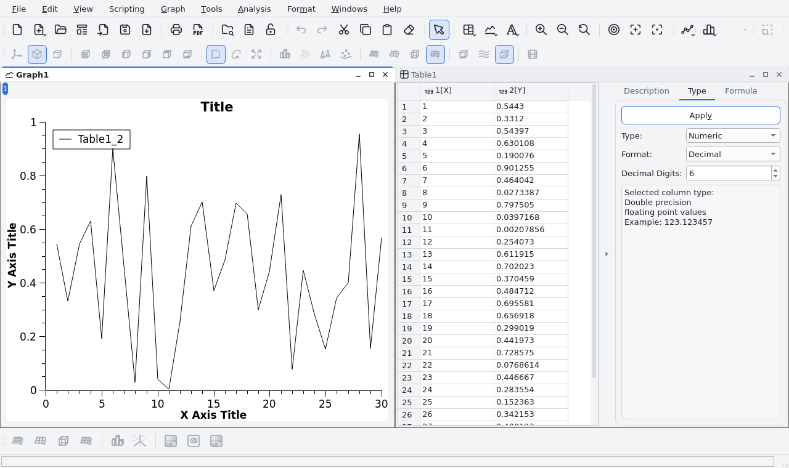

# SciDAVis

[English](README.md) | **Português**

O **SciDAVis** (*Sci*entific *D*ata *A*nalysis and *Vis*ualization) é um aplicativo livre para
análise e visualização de dados científicos: planilhas e matrizes, gráficos 2D e 3D com qualidade
de publicação, ajuste de curvas, FFT, integração, suavização e estatística, com fórmulas e scripts
em Python. É escrito em C++20 com Qt 6 e roda em Linux, Windows e macOS.

<picture>
  <source media="(prefers-color-scheme: dark)" srcset="docs/screenshots/scidavis-dark.png">
  
</picture>

- **Documentação para desenvolvedores**: [wiki do projeto](https://github.com/rafaelos134/scidavis/wiki/Home-pt-BR)
  (funcionalidades, arquitetura, onde estão os cálculos, temas e ícones, ...)
- **Manual do usuário**: <https://highperformancecoder.github.io/scidavis-handbook/>
- **Licença**: GPL v2 ou posterior, veja [LICENSE](LICENSE) e [CREDITS.md](CREDITS.md)

## Organização do código-fonte

Toda a lógica do programa fica na biblioteca `libscidavis`, agrupada por módulo. Todas as pastas
de módulo estão no include path, então os headers são incluídos só pelo nome (`#include "Graph.h"`).

```
libscidavis/src/
├── app/            Janela principal e infraestrutura
├── project/        Objetos do projeto (janelas filhas)
├── analysis/       Operações numéricas sobre curvas
│   └── fit/        Ajuste de curvas (regressão)
├── plot/           Gráficos 2D: camadas, curvas, eixos, legendas
│   ├── 3d/         Gráficos 3D
│   └── tools/      Ferramentas interativas do mouse
├── scripting/      muParser, Python, editor de scripts, bindings SIP
├── dialogs/        Caixas de diálogo
├── widgets/        Componentes visuais reutilizáveis
├── io/             Importação/exportação de formatos externos
└── future/         Framework "aspect" (nova camada de dados)
    ├── core/       AbstractAspect, Project, Column, filtros de tipo de dado
    ├── table/      Modelo/visão da tabela (MVC)
    ├── matrix/     Modelo/visão da matriz (MVC)
    └── lib/        Utilitários (Interval, XmlStreamReader, ActionManager)
```

O executável (`scidavis/`), os testes, os plugins, a documentação e o empacotamento estão descritos
na página [Estrutura do repositório](https://github.com/rafaelos134/scidavis/wiki/Repository-Structure-pt-BR)
da wiki.

## Compilando e testando

Requisitos: **Qt 6.8 LTS** (Core, Gui, Widgets, Svg, PrintSupport, Xml, OpenGL, OpenGLWidgets e
LinguistTools), compilador com **C++20** (GCC 11+, Clang 14+, MSVC 2022), CMake 3.16+, GSL,
muParser e zlib. A Qwt 5 e a QwtPlot3D são compiladas junto com o SciDAVis (não use os pacotes
`libqwt*` da distribuição, que são para Qt 5).

Exemplo para Linux (Debian/Ubuntu). As distribuições costumam trazer um Qt 6 mais antigo que o
6.8, então ele é instalado em `~/Qt` com o [aqtinstall](https://github.com/miurahr/aqtinstall), sem
precisar de `sudo`:

```bash
sudo apt install build-essential cmake ninja-build libgl1-mesa-dev libglu1-mesa-dev \
                 libxkbcommon-dev libxcb-cursor0 libmuparser-dev libgsl-dev zlib1g-dev libgtest-dev
pip install --user aqtinstall
python3 -m aqt install-qt linux desktop 6.8.3 linux_gcc_64 -O ~/Qt

git clone --recursive https://github.com/rafaelos134/scidavis.git
cd scidavis
cmake -S . -B build -G Ninja -DCMAKE_BUILD_TYPE=Release \
      -DCMAKE_PREFIX_PATH=$HOME/Qt/6.8.3/gcc_64 \
      -DSEARCH_FOR_UPDATES=OFF -DDOWNLOAD_LINKS=OFF   # opcional: -DORIGIN_IMPORT=ON
cmake --build build -j$(nproc)
./build/scidavis/scidavis
```

Clonou sem `--recursive`? Rode `git submodule update --init --recursive`.

Testes (GoogleTest):

```bash
cmake -S . -B build -DBUILD_TESTS=ON && cmake --build build -j$(nproc)
cd build && ctest --output-on-failure        # em máquina sem tela: xvfb-run ctest ...
```

Opções do CMake: `SCRIPTING_MUPARSER` (ON), `SCRIPTING_PYTHON` (OFF), `ORIGIN_IMPORT` (OFF),
`BUILD_TESTS` (OFF), `SEARCH_FOR_UPDATES` (ON), `DOWNLOAD_LINKS` (ON).

### Scripts em Python (opcional)

Precisam de SIP 6 e de um **PyQt6 compilado contra o mesmo Qt** do SciDAVis: os pacotes `PyQt6`
do PyPI trazem uma cópia própria do Qt e travam se carregados dentro do SciDAVis. Exemplo com um
ambiente virtual (a compilação do PyQt6 leva de 30 a 60 minutos):

```bash
python3 -m venv --system-site-packages ~/Qt/pyqt6-venv
~/Qt/pyqt6-venv/bin/pip install "sip>=6.8" "PyQt-builder>=1.16" "PyQt6-sip>=13.8"
# baixe e extraia o código-fonte do PyQt6 6.8 (pyqt6-6.8.1.tar.gz no PyPI) e, dentro dele:
~/Qt/pyqt6-venv/bin/sip-install --qmake ~/Qt/6.8.3/gcc_64/bin/qmake --confirm-license \
    --no-designer-plugin --no-qml-plugin --no-dbus-python --jobs 4 \
    --enable QtCore --enable QtGui --enable QtWidgets --enable QtPrintSupport --enable QtSvg

cmake -S . -B build -DCMAKE_PREFIX_PATH=$HOME/Qt/6.8.3/gcc_64 -DSCRIPTING_PYTHON=ON \
      -DPython3_EXECUTABLE=$HOME/Qt/pyqt6-venv/bin/python
```

Mais detalhes na página [Scripts em Python](https://github.com/rafaelos134/scidavis/wiki/Python-Scripting-pt-BR)
da wiki; outras plataformas estão em [INSTALL.md](INSTALL.md) (em inglês).

## Como contribuir

Comece pelo [CONTRIBUTING.pt-BR.md](CONTRIBUTING.pt-BR.md): preparação do ambiente, onde fica cada
parte do programa, regras do código, testes e pull requests. As melhorias planejadas estão em
[docs/ROADMAP.md](docs/ROADMAP.md), e a [wiki](https://github.com/rafaelos134/scidavis/wiki/Home-pt-BR)
explica a arquitetura.

Para criar uma análise nova: herde de `Filter` (ou de `Fit` para ajustes) em `analysis/`,
implemente `calculateOutputData()` (ou as funções-modelo em `fit_gsl.cpp`) e crie o diálogo em
`dialogs/`.
